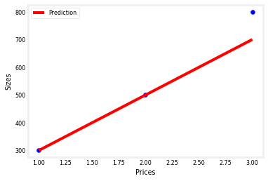

Optional Lab: Model Representation
==================================

.. raw:: html

   <figure>

.. raw:: html

   </figure>

Goals
-----

In this lab you will: - Learn to implement the model :math:`f_{w,b}` for
linear regression with one variable

Notation
--------

Here is a summary of some of the notation you will encounter.

| \|General Notation \| Description\| Python (if applicable) \| \|:
  ————|: ————————————————————|\| \| :math:`a` \| scalar, non bold \|\|
  \| :math:`\mathbf{a}` \| vector, bold \|\| \| **Regression** \| \| \|
  \| \| :math:`\mathbf{x}` \| Training Example feature values (in this
  lab - Size (1000 sqft)) \| ``x_train`` \|
| \| :math:`\mathbf{y}` \| Training Example targets (in this lab Price
  (1000s of dollars)) \| ``y_train`` \| :math:`x^{(i)}`, :math:`y^{(i)}`
  \| :math:`i_{th}`\ Training Example \| ``x_i``, ``y_i``\ \| \| m \|
  Number of training examples \| ``m``\ \| \| :math:`w` \| parameter:
  weight \| ``w`` \| \| :math:`b` \| parameter: bias \| ``b`` \|
| \| :math:`f_{w,b}(x^{(i)})` \| The result of the model evaluation at
  :math:`x^{(i)}` parameterized by :math:`w,b`:
  :math:`f_{w,b}(x^{(i)}) = wx^{(i)}+b` \| ``f_wb`` \|

Tools
-----

In this lab you will make use of: - NumPy, a popular library for
scientific computing - Matplotlib, a popular library for plotting data

.. code:: ipython3

    import numpy as np
    import matplotlib.pyplot as plt
    plt.style.use('./deeplearning.mplstyle')

Problem Statement
=================

| As in the lecture, you will use the motivating example of housing
  price prediction.
| This lab will use a simple data set with only two data points - a
  house with 1000 square feet(sqft) sold for \\$300,000 and a house with
  2000 square feet sold for \\$500,000. These two points will constitute
  our *data or training set*. In this lab, the units of size are 1000
  sqft and the units of price are 1000s of dollars.

================ ========================
Size (1000 sqft) Price (1000s of dollars)
================ ========================
1.0              300
2.0              500
================ ========================

You would like to fit a linear regression model (shown above as the blue
straight line) through these two points, so you can then predict price
for other houses - say, a house with 1200 sqft.

Please run the following code cell to create your ``x_train`` and
``y_train`` variables. The data is stored in one-dimensional NumPy
arrays.

.. code:: ipython3

    # x_train is the input variable (size in 1000 square feet)
    # y_train is the target (price in 1000s of dollars)
    x_train = np.array([1.0, 2.0, 3.0])
    y_train = np.array([300.0, 500.0, 800.0])
    print(f"x_train = {x_train}")
    print(f"y_train = {y_train}")

.. parsed-literal::

    x_train = [1. 2. 3.]
    y_train = [300. 500. 800.]

   **Note**: The course will frequently utilize the python ‘f-string’
   output formatting described
   `here <https://docs.python.org/3/tutorial/inputoutput.html>`__ when
   printing. The content between the curly braces is evaluated when
   producing the output.

Number of training examples ``m``
~~~~~~~~~~~~~~~~~~~~~~~~~~~~~~~~~

You will use ``m`` to denote the number of training examples. Numpy
arrays have a ``.shape`` parameter. ``x_train.shape`` returns a python
tuple with an entry for each dimension. ``x_train.shape[0]`` is the
length of the array and number of examples as shown below.

.. code:: ipython3

    # m is the number of training examples
    print(f"y_train.shape: {y_train.shape}")
    m = y_train.shape[0]
    n = x_train.shape[0]
    print(f"Number of training examples in n or x is: {n}")
    print(f"Number of training examples in m or y is: {m}")

.. parsed-literal::

    y_train.shape: (3,)
    Number of training examples in n or x is: 3
    Number of training examples in m or y is: 3

One can also use the Python ``len()`` function as shown below.

.. code:: ipython3

    # m is the number of training examples
    m = len(x_train)
    print(f"Number of training examples is: {m}")

.. parsed-literal::

    Number of training examples is: 3

Training example ``x_i, y_i``
~~~~~~~~~~~~~~~~~~~~~~~~~~~~~

You will use (x\ :math:`^{(i)}`, y\ :math:`^{(i)}`) to denote the
:math:`i^{th}` training example. Since Python is zero indexed,
(x\ :math:`^{(0)}`, y\ :math:`^{(0)}`) is (1.0, 300.0) and
(x\ :math:`^{(1)}`, y\ :math:`^{(1)}`) is (2.0, 500.0).

To access a value in a Numpy array, one indexes the array with the
desired offset. For example the syntax to access location zero of
``x_train`` is ``x_train[0]``. Run the next code block below to get the
:math:`i^{th}` training example.

.. code:: ipython3

    i = 2
    x_i = x_train[i]
    y_i = y_train[i]
    print(f"x^({i}) , y^({i})=({x_i} , {y_i})")

.. parsed-literal::

    x^(2) , y^(2)=(3.0 , 800.0)

.. code:: ipython3

    i = 4
    x_i = x_train[i]
    y_i = y_train[i]
    print(f"x^({i}) , y^({i})=({x_i} , {y_i})")

::

    ---------------------------------------------------------------------------

    IndexError                                Traceback (most recent call last)

    <ipython-input-99-911d080f2aae> in <module>
          1 i = 4
    ----> 2 x_i = x_train[i]
          3 y_i = y_train[i]
          4 print(f"x^({i}) , y^({i})=({x_i} , {y_i})")

    IndexError: index 4 is out of bounds for axis 0 with size 3

Plotting the data
~~~~~~~~~~~~~~~~~

You can plot these two points using the ``scatter()`` function in the
``matplotlib`` library, as shown in the cell below. - The function
arguments ``marker`` and ``c`` show the points as red crosses (the
default is blue dots).

You can use other functions in the ``matplotlib`` library to set the
title and labels to display

.. code:: ipython3

    plt.scatter(x_train, y_train, marker="o", c="purple")
    plt.ylabel("Prices")
    plt.xlabel("Sizes")
    plt.title("Housing Prices")
    plt.show()

Model function
--------------

As described in lecture, the model function for linear regression (which
is a function that maps from ``x`` to ``y``) is represented as

.. math::  f_{w,b}(x^{(i)}) = wx^{(i)} + b \tag{1}

The formula above is how you can represent straight lines - different
values of :math:`w` and :math:`b` give you different straight lines on
the plot.

Let’s try to get a better intuition for this through the code blocks
below. Let’s start with :math:`w = 100` and :math:`b = 100`.

**Note: You can come back to this cell to adjust the model’s w and b
parameters**

.. code:: ipython3

    w = 200
    b = 100
    print(f"w: {w}")
    print(f"b: {b}")

.. parsed-literal::

    w: 200
    b: 100

Now, let’s compute the value of :math:`f_{w,b}(x^{(i)})` for your two
data points. You can explicitly write this out for each data point as -

for :math:`x^{(0)}`, ``f_wb = w * x[0] + b``

for :math:`x^{(1)}`, ``f_wb = w * x[1] + b``

| For a large number of data points, this can get unwieldy and
  repetitive. So instead, you can calculate the function output in a
  ``for`` loop as shown in the ``compute_model_output`` function below.
  > **Note**: The argument description ``(ndarray (m,))`` describes a
  Numpy n-dimensional array of shape (m,). ``(scalar)`` describes an
  argument without dimensions, just a magnitude.
| > **Note**: ``np.zero(n)`` will return a one-dimensional numpy array
  with :math:`n` entries

.. code:: ipython3

    def compute_model_output(x, w, b):
        """
        Computes the prediction of a linear model
        Args:
          x (ndarray (m,)): Data, m examples 
          w,b (scalar)    : model parameters  
        Returns
          f_wb (ndarray (m,)): model prediction
        """
        m = x.shape[0]
        f_wb = np.zeros(m)
        
        for i in range(m):
            f_wb[i] = w*x[i] + b 
        return f_wb

Now let’s call the ``compute_model_output`` function and plot the
output..

.. code:: ipython3

    tmp_f_wb = compute_model_output(x_train, w, b,)
    
    plt.plot(x_train, tmp_f_wb, c="r", label = "Prediction")
    plt.scatter(x_train, y_train, marker="o", c="b")
    plt.xlabel("Prices")
    plt.ylabel("Sizes")
    plt.legend()
    plt.show()
    
    # # Plot our model prediction
    # plt.plot(x_train, tmp_f_wb, c='b',label='Our Prediction')
    
    # # Plot the data points
    # plt.scatter(x_train, y_train, marker='x', c='r',label='Actual Values')
    
    # # Set the title
    # plt.title("Housing Prices")
    # # Set the y-axis label
    # plt.ylabel('Price (in 1000s of dollars)')
    # # Set the x-axis label
    # plt.xlabel('Size (1000 sqft)')
    # plt.legend()
    # plt.show()

As you can see, setting :math:`w = 100` and :math:`b = 100` does *not* result in a line that fits our data.
===========================================================================================================

Challenge
~~~~~~~~~

Try experimenting with different values of :math:`w` and :math:`b`. What
should the values be for a line that fits our data?

Tip:
^^^^

You can use your mouse to click on the green “Hints” below to reveal
some hints for choosing b and w.

.. raw:: html

   

Hints

.. raw:: html

   

.. raw:: html

   <ul>

.. raw:: html

   <li>

Try :math:`w = 200` and :math:`b = 100`

.. raw:: html

   </li>

.. raw:: html

   </ul>

.. raw:: html

   

Prediction
~~~~~~~~~~

Now that we have a model, we can use it to make our original prediction.
Let’s predict the price of a house with 1200 sqft. Since the units of
:math:`x` are in 1000’s of sqft, :math:`x` is 1.2.

.. code:: ipython3

    w = 200                         
    b = 100    
    x_i = 1.2
    cost_1200sqft = w * x_i + b    
    
    print(f"${cost_1200sqft:.0f} thousand dollars")

.. parsed-literal::

    $340 thousand dollars

Congratulations!
================

In this lab you have learned: - Linear regression builds a model which
establishes a relationship between features and targets - In the example
above, the feature was house size and the target was house price - for
simple linear regression, the model has two parameters :math:`w` and
:math:`b` whose values are ‘fit’ using *training data*. - once a model’s
parameters have been determined, the model can be used to make
predictions on novel data.

